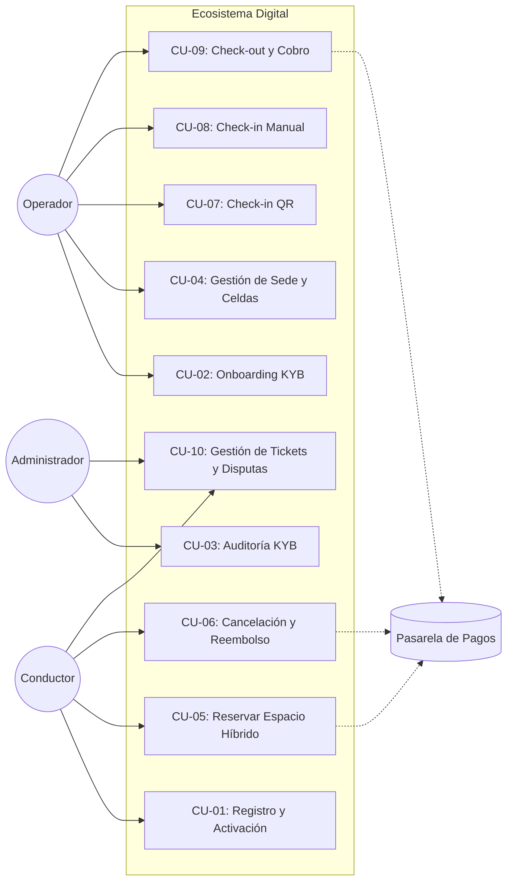

# Casos de Uso y Escenarios — LOCIFY

Este documento detalla los 10 casos de uso principales del sistema, incluyendo escenarios de éxito y flujos alternativos (errores y contingencias).

## Diagrama General de Casos de Uso

## Detalle de los Casos de Uso

### CU-01: Registro y Activación
- **Actor:** Conductor / Operador.
- **Flujo:** El usuario llena el formulario. El sistema envía un correo con token (24h). El usuario hace clic y activa su cuenta.
- **Excepción:** Si el token expira, el sistema permite solicitar un nuevo enlace.

### CU-02: Onboarding KYB
- **Actor:** Operador.
- **Flujo:** El operador sube el RUT y fotos. El sistema genera un Ticket en estado "En Revisión".
- **Regla:** La sede no se muestra en el mapa hasta que el Admin apruebe el ticket.

### CU-03: Auditoría KYB
- **Actor:** Administrador.
- **Flujo:** El admin revisa el ticket. Si aprueba, la sede se activa. Si rechaza, debe escribir el motivo.
- **Excepción:** El operador puede volver a subir documentos si fue rechazado.

### CU-04: Gestión de Sede y Celdas
- **Actor:** Operador.
- **Flujo:** El operador define cuántas celdas tiene (ej. 10 para carros, 5 para motos). El sistema actualiza la capacidad disponible.

### CU-05: Reservar Espacio Híbrido
- **Actor:** Conductor. **Secundario:** Pasarela de Pagos.
- **Flujo:** El conductor elige modalidad:
  - **Garantizada:** Paga y el cupo se bloquea.
  - **Exprés:** El sistema genera QR y un temporizador de 5 min.
- **Regla:** Si el conductor tiene doble reserva con la misma placa, el sistema lo bloquea.

### CU-06: Cancelación y Reembolso
- **Actor:** Conductor.
- **Flujo:** El conductor cancela desde la app. El sistema evalúa la regla:
  - Si es Exprés y está en tiempo: Cancela sin penalidad.
  - Si es Garantizada y faltan >30 min: Devuelve el dinero o da crédito.
- **Excepción:** Si el tiempo ya pasó, se aplica penalidad.

### CU-07: Check-in QR
- **Actor:** Operador / Conductor.
- **Flujo:** Se escanea el QR. El sistema valida y arranca el cronómetro.
- **Excepción:** QR expirado -> Muestra mensaje de "Reserva Caducada" y libera el cupo.

### CU-08: Check-in Manual (Contingencia)
- **Actor:** Operador.
- **Flujo:** Si el escáner falla, el operador busca la reserva por placa y hace clic en "Ingreso Manual".
- **Regla:** Se debe registrar una nota explicando el fallo técnico.

### CU-09: Check-out y Cobro
- **Actor:** Operador.
- **Flujo:** El operador da salida. El sistema calcula el tiempo y cobra a la tarjeta del cliente automáticamente.
- **Excepción:** Si el pago falla, el sistema envía un correo al cliente con un enlace de pago para que pueda salir (sin bloquear el vehículo).

### CU-10: Gestión de Tickets y Disputas
- **Actor:** Conductor, Operador y Administrador.
- **Flujo:** El cliente abre un ticket. El operador intenta resolverlo. Si no puede, lo escala al Admin, quien revisa la cronología y decide.