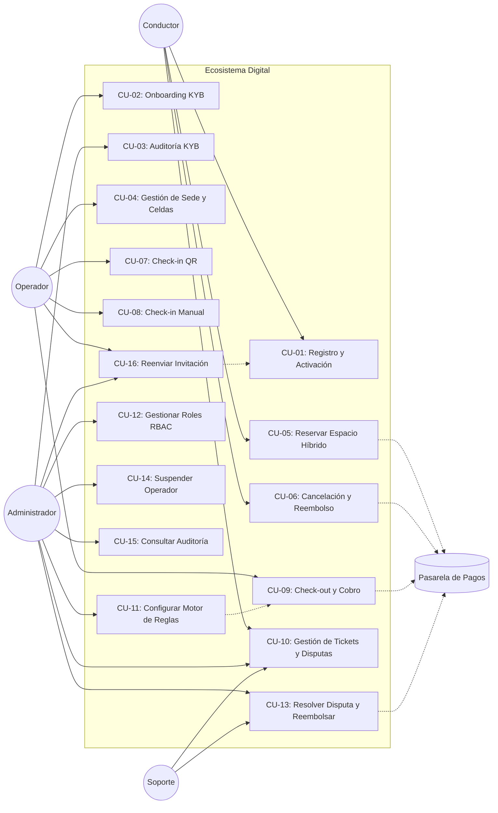

# Casos de Uso y Escenarios — LOCIFY

Este documento detalla los 16 casos de uso principales del sistema, incluyendo escenarios de éxito y flujos alternativos (errores y contingencias). Los casos CU-11 a CU-16 (2026-10-28) corresponden al Administrador de LOCIFY y responden a las historias [HU-A05…HU-A11](./05-historias-usuario.md#épica-6-administrador-locify--operación-del-saas).

## Diagrama General de Casos de Uso

## Detalle de los Casos de Uso

### CU-01: Registro y Activación
- **Actor:** Conductor / Operador.
- **Flujo:** El usuario llena el formulario. El sistema envía un correo con token (24h). El usuario hace clic y activa su cuenta.
- **Excepción:** Si el token expira, el sistema permite solicitar un nuevo enlace.

### CU-02: Onboarding KYB
- **Actor:** Operador.
- **Flujo:** El operador sube el RUT y fotos. El sistema genera un Ticket en estado "En Revisión".
- **Regla:** La sede no se muestra en el mapa hasta que el Admin apruebe el ticket.

### CU-03: Auditoría KYB
- **Actor:** Administrador.
- **Flujo:** El admin revisa el ticket. Si aprueba, la sede se activa. Si rechaza, debe escribir el motivo.
- **Excepción:** El operador puede volver a subir documentos si fue rechazado.

### CU-04: Gestión de Sede y Celdas
- **Actor:** Operador.
- **Flujo:** El operador define cuántas celdas tiene (ej. 10 para carros, 5 para motos). El sistema actualiza la capacidad disponible.

### CU-05: Reservar Espacio Híbrido
- **Actor:** Conductor. **Secundario:** Pasarela de Pagos.
- **Flujo:** El conductor elige modalidad:
  - **Garantizada:** Paga y el cupo se bloquea.
  - **Exprés:** El sistema genera QR y un temporizador de 5 min.
- **Regla:** Si el conductor tiene doble reserva con la misma placa, el sistema lo bloquea.

### CU-06: Cancelación y Reembolso
- **Actor:** Conductor.
- **Flujo:** El conductor cancela desde la app. El sistema evalúa la regla:
  - Si es Exprés y está en tiempo: Cancela sin penalidad.
  - Si es Garantizada y faltan >30 min: Devuelve el dinero o da crédito.
- **Excepción:** Si el tiempo ya pasó, se aplica penalidad.

### CU-07: Check-in QR
- **Actor:** Operador / Conductor.
- **Flujo:** Se escanea el QR. El sistema valida y arranca el cronómetro.
- **Excepción:** QR expirado -> Muestra mensaje de "Reserva Caducada" y libera el cupo.

### CU-08: Check-in Manual (Contingencia)
- **Actor:** Operador.
- **Flujo:** Si el escáner falla, el operador busca la reserva por placa y hace clic en "Ingreso Manual".
- **Regla:** Se debe registrar una nota explicando el fallo técnico.

### CU-09: Check-out y Cobro
- **Actor:** Operador.
- **Flujo:** El operador da salida. El sistema calcula el tiempo y cobra a la tarjeta del cliente automáticamente.
- **Excepción:** Si el pago falla, el sistema envía un correo al cliente con un enlace de pago para que pueda salir (sin bloquear el vehículo).

### CU-10: Gestión de Tickets y Disputas
- **Actor:** Conductor, Operador y Administrador.
- **Flujo:** El cliente abre un ticket. El operador intenta resolverlo. Si no puede, lo escala al Admin, quien revisa la cronología y decide.

---

## Casos de Uso del Administrador de LOCIFY (CU-11 a CU-16)

Responden a la [HU-A05…HU-A11](./05-historias-usuario.md#épica-6-administrador-locify--operación-del-saas) del backlog del SaaS. Todos exigen sesión con JWT válido y se evalúan con RBAC en cada petición (RF-32); una respuesta 403 indica que el rol no alcanza.

### CU-11: Configurar Motor de Reglas
- **Actor:** Administrador. **RF:** RF-31. **Historias:** HU-A05, HU-22.
- **Precondición:** Sesión con `rol=ADMIN`.
- **Flujo principal (éxito):**
  1. El admin abre el panel de reglas y configura minutos de gracia, tarifa base y fracción mínima de cobro.
  2. El sistema valida los valores (rangos y unidades); si son válidos, persiste la nueva versión.
  3. Las reservas **nuevas** aplican la configuración vigente; las reservas **en curso** conservan la tarifa con que se crearon.
- **Escenario alternativo 1 (valor inválido):** gracia negativa o tarifa 0 → rechazo con 400 y mensaje que nombra el campo; la configuración vigente no se altera.
- **Escenario alternativo 2 (rol insuficiente):** un SOPORTE intenta editar (vía CU-12) → 403 sin cambios.
- **Postcondición:** el cambio queda en el log de auditoría como evento (CU-15).

### CU-12: Gestionar Roles de Usuario (RBAC)
- **Actor:** Administrador. **RF:** RF-32. **Historias:** HU-A06, HU-04.
- **Precondición:** Sesión con `rol=ADMIN`.
- **Flujo principal (éxito):**
  1. El admin crea la cuenta interna (Superadmin, Financiero o Soporte) con email y contraseña con la política de complejidad RF-06.
  2. La cuenta nace PENDIENTE y recibe el correo de activación del onboarding (CU-01).
  3. En cada request el sistema aplica la política de rol: Soporte ve tickets y disputas, Financiero ve reportes, solo Superadmin configura el motor de reglas (RF-31).
- **Escenario alternativo 1 (rol insuficiente):** operación fuera del alcance del rol → 403; se audita el intento (CU-15).
- **Escenario alternativo 2 (cuenta suspendida):** el login da 403 lo mismo que para operadores (RF-08).
- **Nota honesta:** hoy la plataforma ya issuer JWT con `rol` y protege la reinvitación con ADMIN; la política por rol para el resto de rutas (CU-11 a CU-13) está especificada, no implementada (RF-32 en *Parcial*).

### CU-13: Resolver Disputa y Emitir Reembolso
- **Actor:** Administrador (secundario: Pasarela de Pagos). **RF:** RF-30, RF-22. **Historias:** HU-A07, HU-24.
- **Precondición:** Existe un ticket escalado (CU-10) o una reserva con queja.
- **Flujo principal (éxito):**
  1. El admin abre la línea de tiempo de la reserva: creación, check-in, check-out, cobros, abonos y ajustes, cada uno con fuente (operador o sistema) e hora.
  2. Si la evidencia confirma el cobro indebido, emite reembolso total o parcial pasando por la pasarela.
  3. El reembolso vuelve a aparecer en la línea de tiempo, el crédito se refleja en el historial del cliente (HU-28) y **no** suma como ingreso en los reportes (RF-28).
- **Escenario alternativo 1 (a favor del operador):** se cierra el ticket justificado; la reserva conserva su estado económico y la timeline queda como evidencia.
- **Escenario alternativo 2 (fallo de pasarela):** el reembolso se marca como pendiente con la causa; se reintenta, sin escribir dos veces el mismo ajuste (RNF-02).

### CU-14: Suspender Operador
- **Actor:** Administrador. **RF:** RF-33 (derivado; apoya RF-08 y RF-24). **Historias:** HU-A08.
- **Precondición:** Operador con quejas acumulada en tickets (CU-10).
- **Flujo principal (éxito):**
  1. El admin marca la cuenta como SUSPENDIDO escribiendo el **motivo obligatorio** (el sistema lo exige).
  2. La sede deja de aparecer en el mapa (HU-08/RF-24), el login del operador responde 403 (RF-08) y su dashboard queda bloqueado.
  3. El ciclo de suspensión queda registrado en el historial de la cuenta y en el log de auditoría.
- **Escenario alternativo 1 (reactivación):** si la queja se resuelve, el admin reactiva la cuenta; la sede vuelve a ser visible y el acceso se restaura.
- **Escenario alternativo 2 (motivo faltante o rol insuficiente):** suspensión sin motivo → 400; intento de un Soporte sin permiso → 403.

### CU-15: Consultar Auditoría del Sistema
- **Actor:** Administrador. **RF:** apoya a RNF-02. **Historias:** HU-A09, HU-A05.
- **Precondición:** Sesión con `rol=ADMIN`.
- **Flujo principal (éxito):**
  1. El admin consulta el log de acciones críticas: cambios de tarifas, suspensiones, reembolsos, aprobaciones KYB y conteos de invitación.
  2. Filtra por actor, tipo de acción y rango de fechas; cada registro muestra actor, rol, acción, fecha/hora, objeto afectado y detalle antes/después.
  3. Si se solicita, el sistema reconstruye la secuencia completa de acciones de un objeto (por ejemplo la tarifa de una sede), sin huecos ni duplicados.
- **Regla (el corazón del caso de uso):** el log es **append-only**. Ningún rol, incluso el ADMIN, puede modificar o eliminar un evento existente; solo se agregan eventos nuevos, de modo que el trazo queda inmutable y deniega la acción que lo intenta anular (RNF-02).
- **Escenario alternativo (sin resultados):** el filtro no arroja eventos → la UI muestra un estado vacío explicativo, no una tabla sin datos.

### CU-16: Reenviar Invitación de Operador
- **Actor:** Administrador. **RF:** RF-04. **Historias:** HU-A11, HU-02.
- **Precondición:** Existe un operador en estado PENDIENTE.
- **Flujo principal (éxito):**
  1. El admin busca al operador por id o email y solicita la reinvitación.
  2. El sistema genera un token nuevo con vigencia de 24 h, lo persiste y reenvía el correo con el enlace `APP_URL/activar?token=…`.
  3. El token anterior queda invalidado porque solo se guarda un token.
- **Escenario alternativo 1 (cuenta no reinvitable):** si la cuenta está ACTIVA o SUSPENDIDA → 400 sin enviar correo.
- **Escenario alternativo 2 (fallo SMTP):** → 502; la cuenta sigue PENDIENTE con token vigente y el cliente puede reintentar sin duplicar el registro (409).
- **Estado en el código: implementado y probado.** Caso de uso `ReinvitarOperadorUseCase` y endpoint `POST /api/operadores/:id/reinvitar` (RBAC: solo ADMIN); ver la fila RF-04 de la [matriz](./07-matriz-trazabilidad.md).