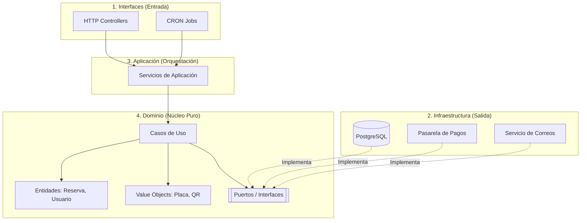

# Arquitectura Hexagonal en LOCIFY

Para garantizar que el código de LOCIFY sea mantenible, testeable y escalable, hemos adoptado el patrón de **Arquitectura Hexagonal** (también conocido como *Ports & Adapters*).

## 1. ¿Por qué Hexagonal y no MVC?

En un proyecto tradicional (MVC), la lógica de negocio suele quedar fuertemente acoplada al framework (ej. Express, NestJS), al ORM (ej. Prisma, TypeORM) o a servicios externos (Stripe). Esto genera dos problemas graves:
1. **Difícil de testear:** Para probar una regla de negocio, necesitas levantar una base de datos o mockear medio framework.
2. **Difícil de cambiar:** Si mañana decidimos cambiar la pasarela de pagos, tendríamos que modificar los controladores, los servicios y los tests.

La Arquitectura Hexagonal resuelve esto poniendo el **Dominio (lógica de negocio pura) en el centro**, aislado de todo lo externo.

## 2. Las 4 Capas de LOCIFY

Cada microservicio (`cliente-api`, `operador-api`, `admin-api`, `pago-worker`) tiene exactamente esta misma estructura interna:



## 3. La Regla de Dependencia

La flechas del diagrama apuntan siempre **hacia el dominio**. Esa es la regla que hace que el patrón funcione:

| Capa | Puede importar de | No puede importar de |
| :--- | :--- | :--- |
| **Dominio** | Nada externo (solo TypeScript estándar) | Prisma, Express, Stripe, Sendgrid |
| **Aplicación** | Dominio | Detalles de infraestructura |
| **Infraestructura** | Dominio (implementa sus puertos) | Aplicación |
| **Interfaces** | Aplicación | Dominio directamente |

Consecuencia práctica: un caso de uso como `RegistrarOperador` se puede probar **sin base de datos**, porque depende de la interfaz `UsuarioRepository` y no de PostgreSQL.

```ts
// src/domain/ports/UsuarioRepository.ts — el dominio define QUÉ necesita
export interface UsuarioRepository {
  guardar(usuario: Usuario): Promise<void>;
  buscarPorEmail(email: string): Promise<Usuario | null>;
  buscarPorId(id: string): Promise<Usuario | null>;
}

// src/infrastructure/persistence/PostgresUsuarioRepository.ts — la infraestructura define CÓMO
export class PostgresUsuarioRepository implements UsuarioRepository {
  // ...
}
```

Si mañana se cambia PostgreSQL por otro motor, cambia el adaptador y **no** el caso de uso.

## 4. Estructura real del microservicio

```text
services/admin-api/src/
├── domain/                       # Núcleo puro: no conoce nada externo
│   ├── entities/Usuario.ts
│   ├── ports/UsuarioRepository.ts
│   └── use-cases/RegistrarOperador.ts
├── application/
│   └── services/AdminService.ts  # Orquesta casos de uso
├── infrastructure/               # Adaptadores de salida
│   └── persistence/
│       ├── PostgresUsuarioRepository.ts
│       └── test-connection.ts
├── interfaces/http/              # Adaptadores de entrada
└── prisma/                       # Contrato y cliente de persistencia
    ├── contract.prisma
    ├── contract.json             # Generado: no editar
    └── db.ts
```

## 5. Cómo se verifica cada capa

| Capa | Tipo de prueba | Comando |
| :--- | :--- | :--- |
| Dominio (entidades, reglas) | Unitaria, sin mocks de base de datos | `npm run test:unit` |
| Adaptador de persistencia | Integración contra PostgreSQL real | `npm run test:repo` |
| Contrato de datos ↔ base de datos | Verificación de esquema | `npx prisma db verify` |
| Todo el microservicio | Suite completa | `npm test` |

Una prueba de integración que pasa contra una base de datos vacía no demuestra nada: antes de correrla hay que aplicar el contrato con `npm run db:init` (o `db update` si el esquema ya existe).