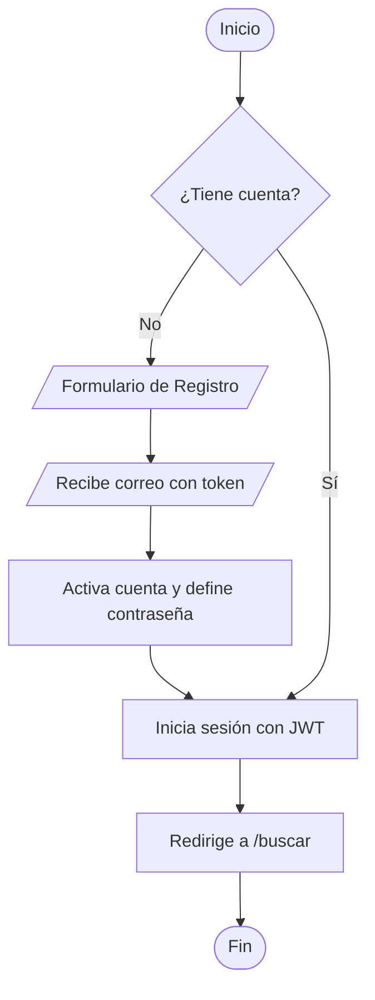

# Flujo 1 - Autenticación del Conductor

**Objetivo:** Permitir que un conductor se registre y acceda de forma segura a la plataforma.

**Actores:** Conductor, Sistema.

**Diagrama de Flujo (Simbología Estándar):**

