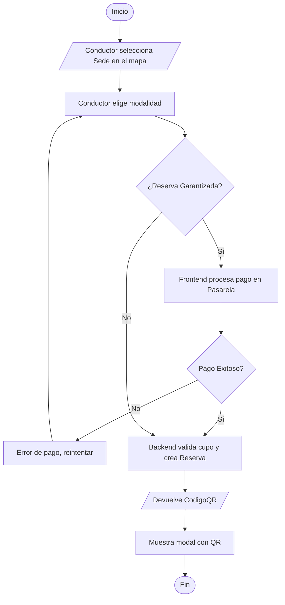

# Flujo 2 - Búsqueda y Reserva

**Objetivo:** Permitir al conductor encontrar un parqueadero en el mapa y asegurar su cupo con o sin pago.

**Actores:** Conductor, Frontend, Backend, Pasarela de Pagos.

**Diagrama de Flujo (Simbología Estándar):**

