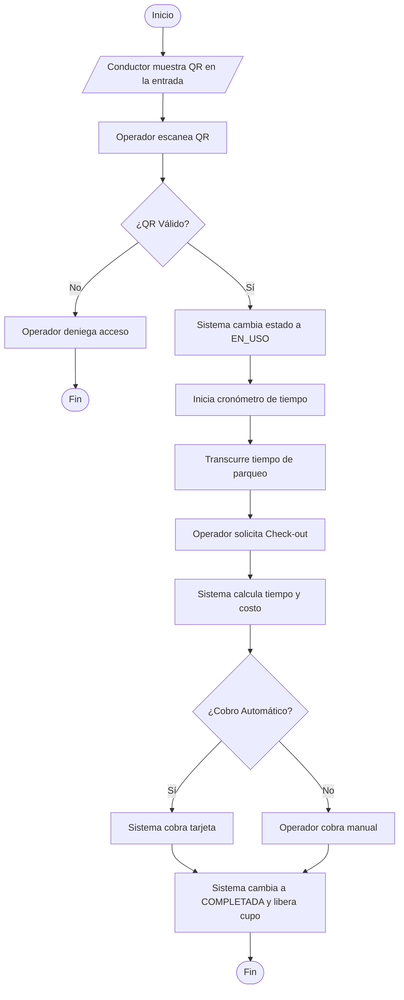

# Flujo 3 - Acceso y Uso del Parqueadero

**Objetivo:** Gestionar el ingreso físico, el tiempo de parqueo y la salida con cobro automático.

**Actores:** Conductor, Operador, Sistema.

**Diagrama de Flujo (Simbología Estándar):**

