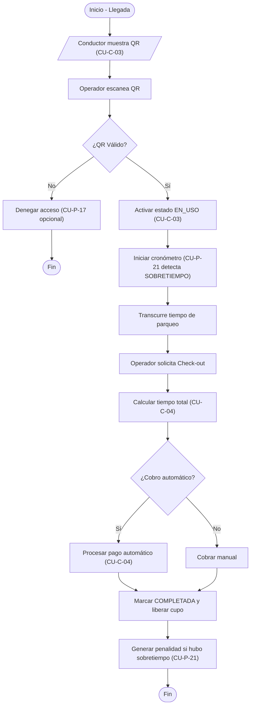

# Flujo 3 - Acceso y Uso del Parqueadero

**Objetivo:** Gestionar el ingreso físico, el tiempo de parqueo y la salida con cobro automático.

**Actores:** Conductor, Operador, Sistema.

**Casos de Uso vinculados:** CU-C-03, CU-C-04, CU-P-15, CU-P-17, CU-P-21

| CU | Nombre | RF | Estado |
|---|---|---|---|
| CU-C-03 | Realizar Check-in | RFC-16 a RFC-19 | ✅ |
| CU-C-04 | Finalizar Uso | RFC-20 a RFC-22 | ✅ |
| CU-P-15 | Registrar ingreso de vehículo | RFP-15 | ✅ |
| CU-P-17 | Forzar salida de vehículo | RFP-17 | ✅ |
| CU-P-21 | Detectar sobretiempos | RFP-21 | ✅ |

**Diagrama de Flujo (Simbología Estándar):**



**Detección de Sobretiempo (CU-P-21):**

```mermaid
flowchart TD
    A[Sistema evaluar estado cada X minutos] --> B{?Tiempo excedido?}
    B -->|Si| C[Generar alerta operador]
    B -->|No| D[Continuar monitoreo]
    C --> E[Registrar penalidad (CU-C-04)]
    E --> F([Fin])
```
