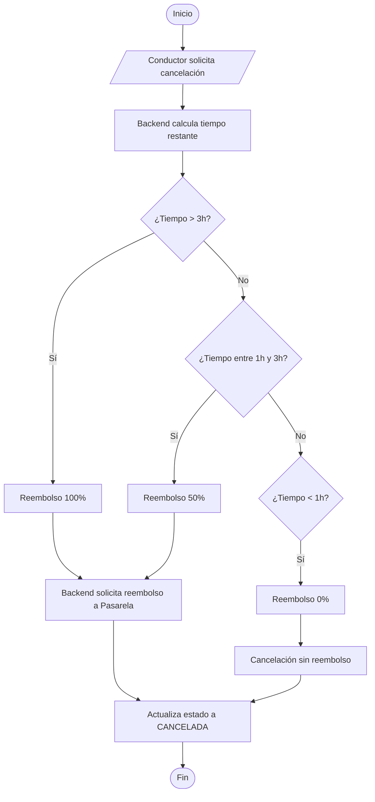

# Flujo 4 - Cancelación y Reembolso

**Objetivo:** Permitir al conductor cancelar una reserva garantizada y calcular el reembolso según la política escalonada por anticipación.

**Actores:** Conductor, Frontend, Backend, Pasarela de Pagos.

**Diagrama de Flujo (Simbología Estándar):**

