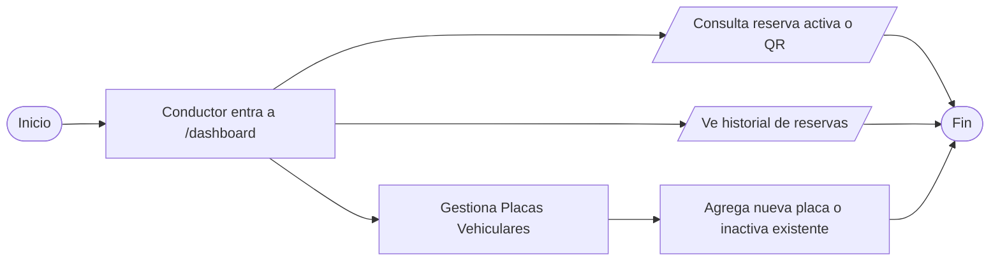

# Flujo 5 - Historial y Gestión de Vehículos

**Objetivo:** Permitir al conductor consultar sus reservas activas, pasadas y gestionar sus placas.

**Actores:** Conductor, Sistema.

**Diagrama de Flujo (Simbología Estándar):**

