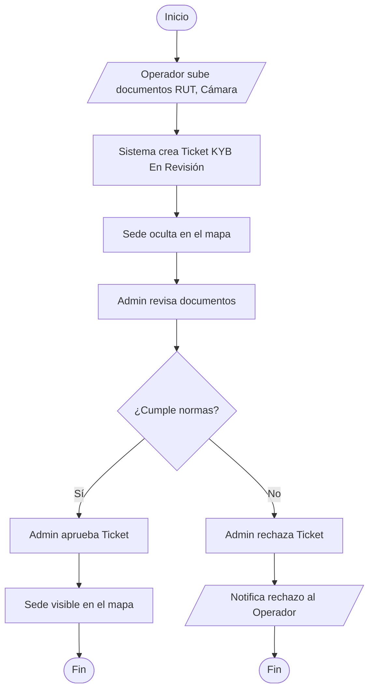

# Flujo 6 - Onboarding KYB

**Objetivo:** Validar legalmente a un operador y su sede antes de que aparezca en el mapa.

**Actores:** Operador, Administrador, Sistema.

**Diagrama de Flujo (Simbología Estándar):**

