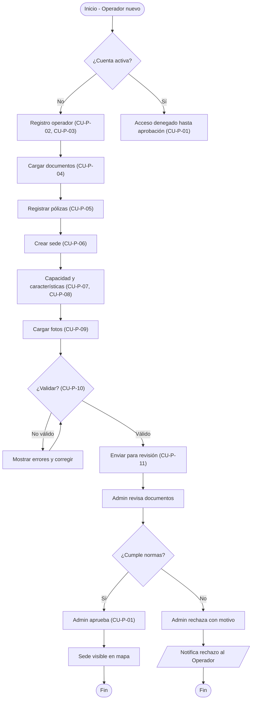
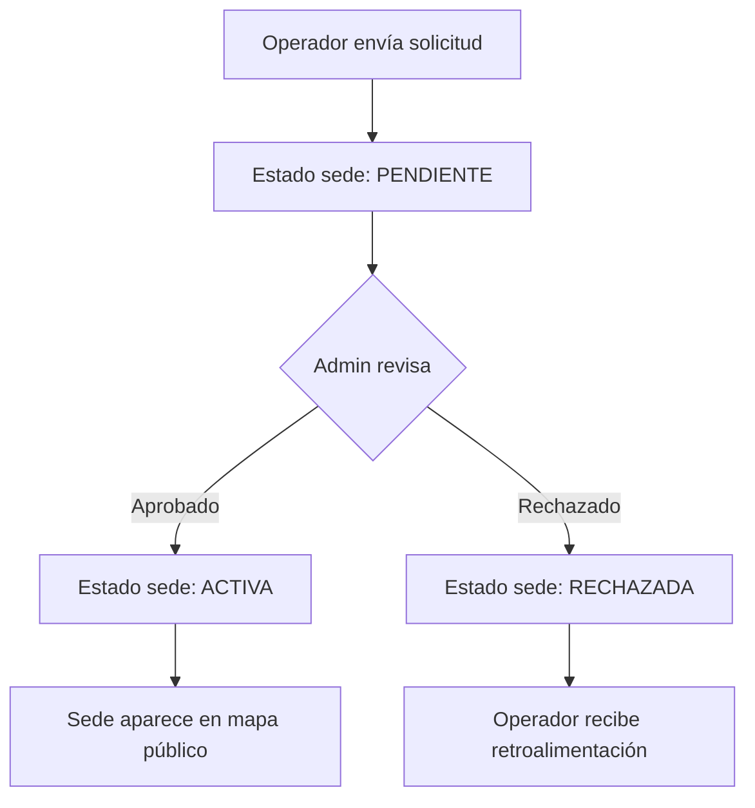

# Flujo 6 - Onboarding KYB (Know Your Business)

**Objetivo:** Validar legalmente a un operador y su sede antes de que aparezca en el mapa.

**Actores:** Operador, Administrador, Sistema.

**Casos de Uso vinculados:** CU-P-01 a CU-P-11

| CU | Nombre | RF | Estado |
|---|---|---|---|
| CU-P-01 | Controlar acceso inicial | RFP-01 | ✅ |
| CU-P-02 | Registrar empresa operadora | RFP-02 | ✅ |
| CU-P-03 | Registrar representante legal | RFP-03 | ✅ |
| CU-P-04 | Cargar documentos obligatorios | RFP-04 | ✅ |
| CU-P-05 | Registrar vigencia de pólizas | RFP-05 | ✅ |
| CU-P-06 | Crear sede de parqueadero | RFP-06 | ✅ |
| CU-P-07 | Registrar capacidad del parqueadero | RFP-07 | ✅ |
| CU-P-08 | Registrar características del parqueadero | RFP-08 | ✅ |
| CU-P-09 | Cargar fotos de la sede | RFP-09 | ✅ |
| CU-P-10 | Validar registro antes del envío | RFP-10 | ✅ |
| CU-P-11 | Enviar solicitud de revisión | RFP-11 | ✅ |

> **Nota:** CU-P-01 y CU-P-11 están referenciados en el flujo de [FT-01 de Onboarding](./flujo-01-autenticacion.md) como precondiciones de acceso.

**Diagrama de Flujo (Simbología Estándar):**

**Flujo de Aprobación (CU-P-01):**

