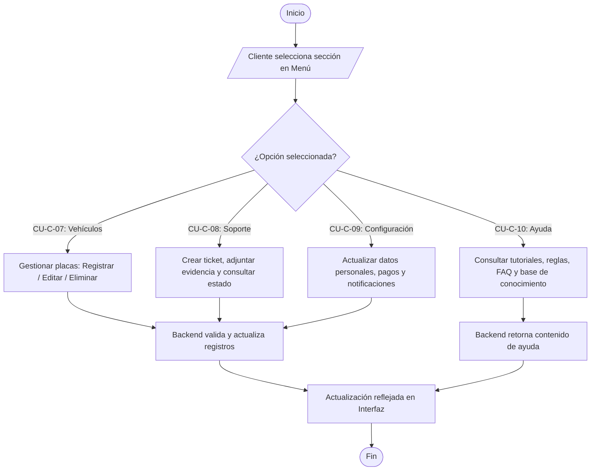

# Flujo 7 - Gestión de Vehículos, Soporte, Configuración y Ayuda

**Objetivo:** Permitir al usuario cliente gestionar sus vehículos asociados, crear y consultar tickets de soporte, actualizar la configuración de su cuenta y consultar el módulo de ayuda y base de conocimiento (Ref: **CU-C-07**, **CU-C-08**, **CU-C-09**, **CU-C-10**).

**Actores:** Conductor/Cliente, Frontend, Backend, Módulo de Soporte.

**Diagrama de Flujo (Simbología Estándar):**

## Escenarios BDD Asociados
- **CU-C-07 (Gestión de Vehículos):** *Given* el cliente accede a mis vehículos, *When* registra una nueva placa válida, *Then* el sistema la asocia a su cuenta de manera exitosa.
- **CU-C-08 (Soporte):** *Given* el cliente experimenta una incidencia, *When* crea un ticket de soporte con evidencia, *Then* el sistema genera el caso y notifica al operador.
- **CU-C-09 (Configuración):** *Given* el cliente desea cambiar sus preferencias, *When* edita su información y guarda, *Then* se actualizan los datos de forma segura.
- **CU-C-10 (Ayuda):** *Given* el cliente tiene dudas sobre el funcionamiento, *When* ingresa al módulo de ayuda, *Then* visualiza las FAQs y tutoriales estructurados.
