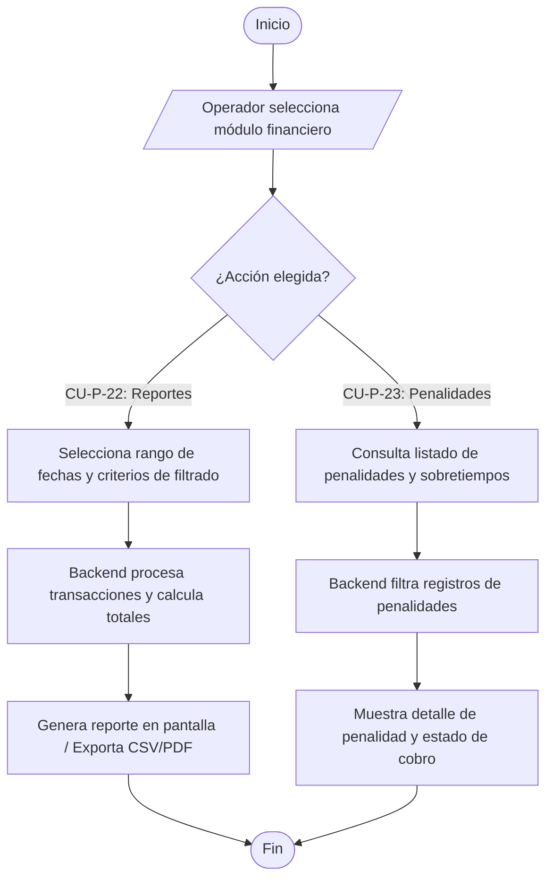

# Flujo 8 - Reportes Financieros y Penalidades (Parqueadero)

**Objetivo:** Permitir al operador del parqueadero generar reportes detallados de ingresos por periodo y consultar el registro de penalidades aplicadas a los usuarios (Ref: **CU-P-22**, **CU-P-23**).

**Actores:** Operador de Parqueadero, Frontend, Backend, Módulo Financiero.

**Diagrama de Flujo (Simbología Estándar):**

## Escenarios BDD Asociados
- **CU-P-22 (Reportes Financieros):** *Given* el operador está en el módulo financiero, *When* selecciona un rango de fechas y solicita el reporte, *Then* el sistema consolida y muestra los ingresos totales desglosados.
- **CU-P-23 (Consulta de Penalidades):** *Given* un vehículo excede el tiempo asignado, *When* el operador revisa el historial de penalidades, *Then* visualiza el listado con montos y estados de cobro asociados.
