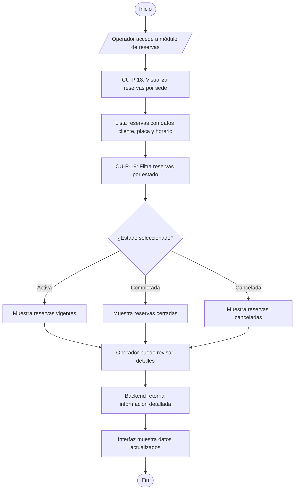

# Flujo 10 - Gestión de Reservas Parqueadero

**Objetivo:** Permitir al operador visualizar y gestionar las reservas activas por sede, filtrando por estado para optimizar la operación (Ref: **CU-P-18**, **CU-P-19**).

**Actores:** Operador de Parqueadero, Frontend, Backend.

**Diagrama de Flujo (Simbología Estándar):**

## Escenarios BDD Asociados
- **CU-P-18 (Visualizar Reservas por Sede):** *Given* operador seleccionado sede, *When* consulta reservas, *Then* visualiza todas las reservas asociadas con datos completos.
- **CU-P-19 (Filtrar por Estado):** *Given* lista de reservas, *When* operador aplica filtro por estado, *Then* sistema muestra solo reservas del estado seleccionado.
