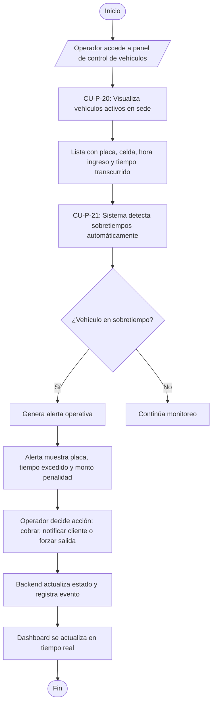

# Flujo 11 - Control de Vehículos y Tiempos

**Objetivo:** Permitir al operador monitorear vehículos activos en la sede y detectar sobretiempos automáticamente para gestionar alertas y penalizaciones (Ref: **CU-P-20**, **CU-P-21**).

**Actores:** Operador de Parqueadero, Frontend, Backend, Sistema de Monitoreo.

**Diagrama de Flujo (Simbología Estándar):**

## Escenarios BDD Asociados
- **CU-P-20 (Vehículos Activos):** *Given* sede operativa, *When* operador consulta vehículos activos, *Then* visualiza lista completa con datos de ingreso y tiempo.
- **CU-P-21 (Detección Sobretiempos):** *Given* vehículo excede tiempo reservado, *When* sistema evalúa automáticamente, *Then* genera alerta con cálculo de penalidad aplicable.
