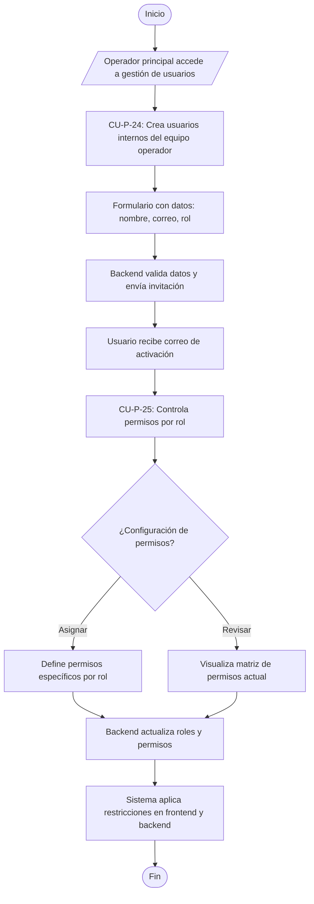

# Flujo 12 - Gestión de Usuarios y Seguridad Parqueadero

**Objetivo:** Permitir al operador crear usuarios internos para su equipo y controlar permisos por rol para garantizar seguridad operativa (Ref: **CU-P-24**, **CU-P-25**).

**Actores:** Operador Principal, Frontend, Backend, Módulo de Seguridad.

**Diagrama de Flujo (Simbología Estándar):**

## Escenarios BDD Asociados
- **CU-P-24 (Crear Usuarios Internos):** *Given* operador principal, *When* crea cuenta para miembro del equipo, *Then* sistema genera invitación y usuario puede activarse.
- **CU-P-25 (Controlar Permisos por Rol):** *Given* usuario inicia sesión, *When* accede a funcionalidad, *Then* sistema valida permisos del rol y bloquea acceso no autorizado.
