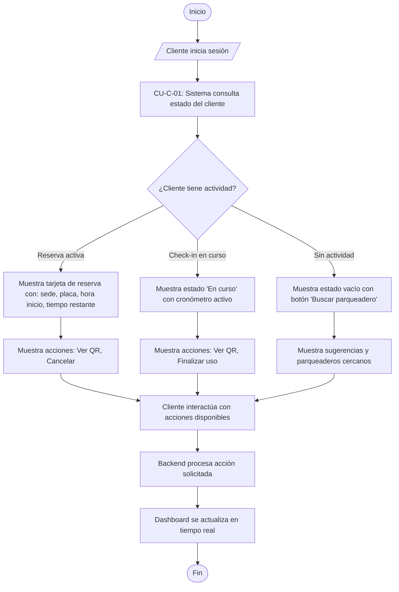

# Flujo 14 - Dashboard Cliente

**Objetivo:** Permitir al cliente visualizar su estado actual, reservas activas, contador de uso y alertas desde el dashboard principal (Ref: **CU-C-01**).

**Actores:** Cliente, Frontend, Backend.

**Diagrama de Flujo (Simbología Estándar):**

## Escenarios BDD Asociados
- **CU-C-01 Escenario 1 (Dashboard con reserva activa):** *Given* usuario logueado tiene reserva garantizada vigente, *When* accede al dashboard, *Then* muestra sede, placa, hora inicio, tiempo restante y acciones disponibles.
- **CU-C-01 Escenario 2 (Dashboard sin reservas):** *Given* usuario sin reservas activas, *When* accede al dashboard, *Then* muestra estado vacío con mensaje indicativo y acción principal de búsqueda.
- **CU-C-01 Escenario 3 (Check-in en curso):** *Given* usuario tiene check-in activo, *When* accede al dashboard, *Then* muestra estado "En curso" con cronómetro desde check-in.
