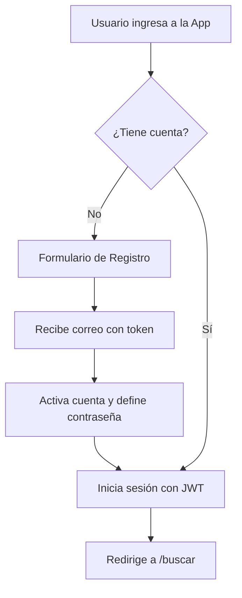
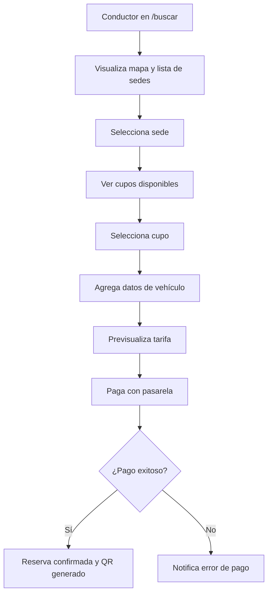
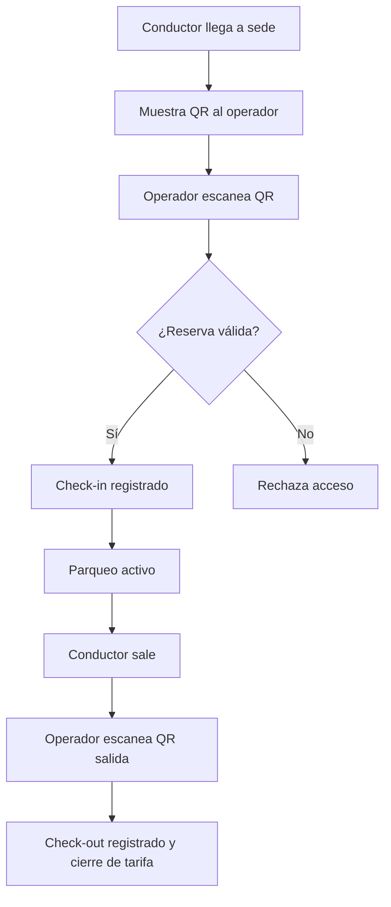
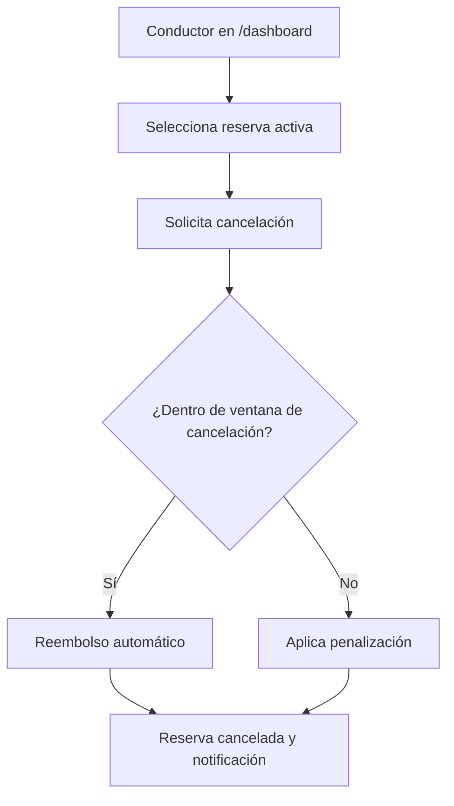
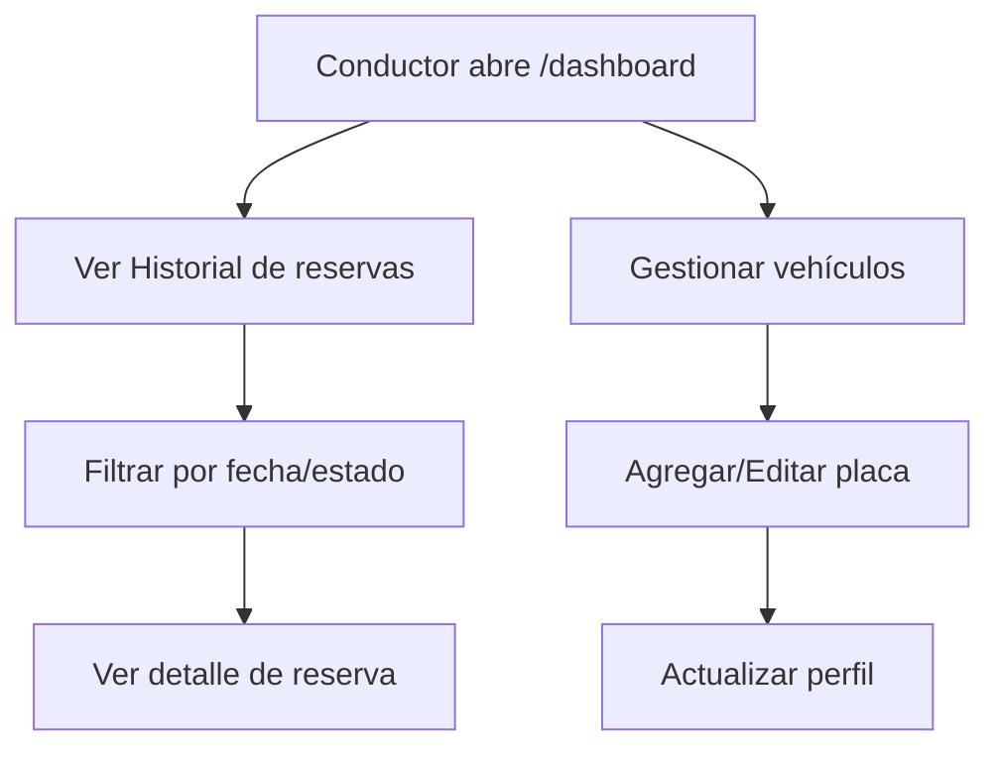
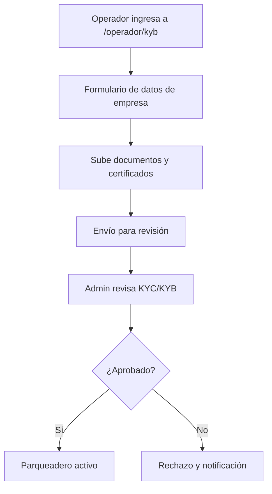
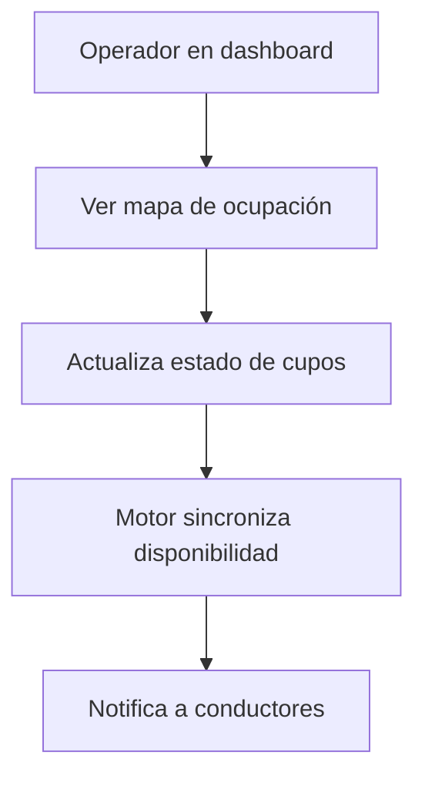
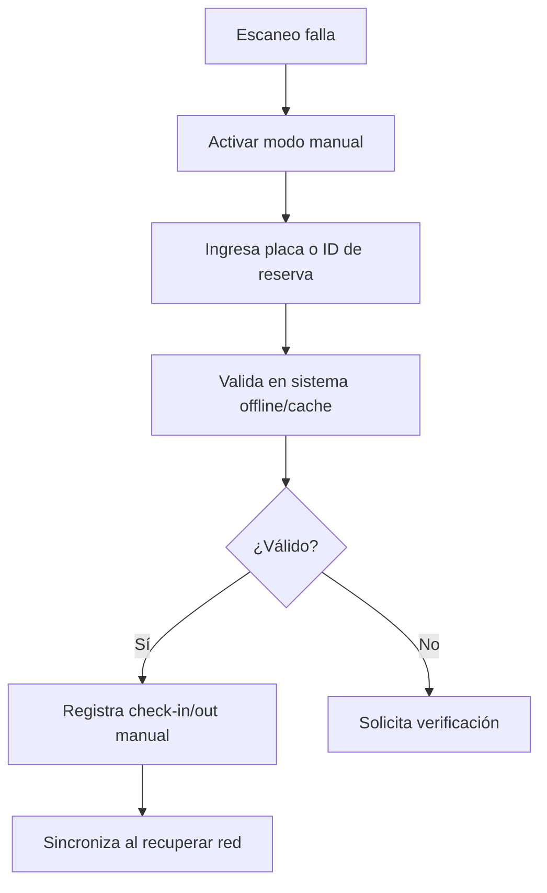
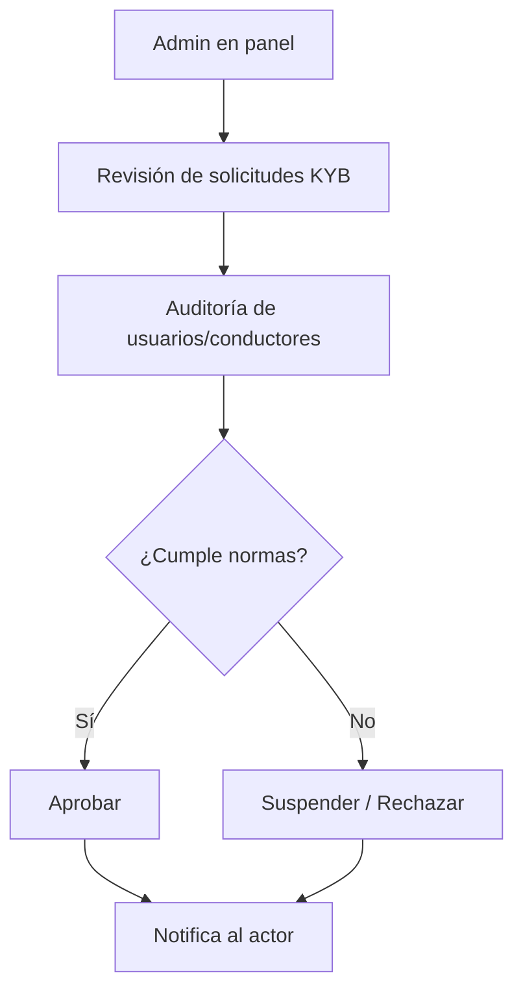
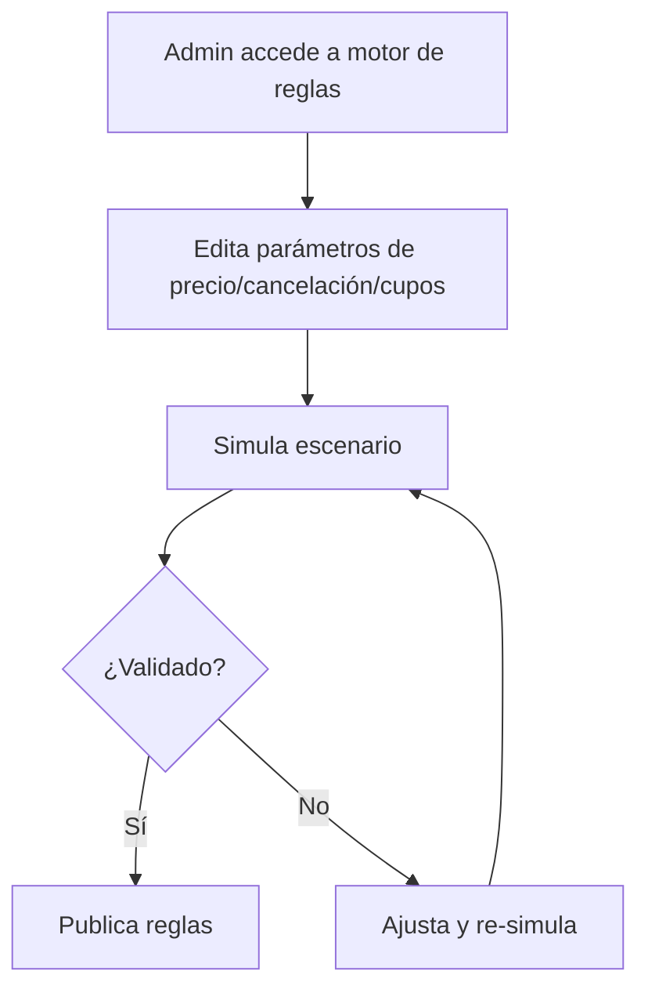

# Mapa Completo de Flujos de Usuario

Este documento detalla los 10 flujos (User Journeys) que componen el ecosistema LOCIFY, garantizando que todos los actores (Conductor, Operador y Administrador) tengan un camino claro y sin fricciones.

## 1. Flujo del Conductor: Autenticación
*   **Actor:** Conductor
*   **Objetivo:** Registrarse y acceder al sistema de forma segura.

## 2. Flujo del Conductor: Búsqueda y Reserva (Crítico)
*   **Actor:** Conductor
*   **Objetivo:** Encontrar un parqueadero y asegurar el cupo.

## 3. Flujo del Conductor: Acceso y Uso (Crítico)
*   **Actor:** Conductor / Operador
*   **Objetivo:** Ingresar al parqueadero y salir pagando lo justo.

## 4. Flujo del Conductor: Cancelación y Reembolso (Crítico)
*   **Actor:** Conductor
*   **Objetivo:** Cancelar una reserva y recibir su dinero de vuelta si aplica.

## 5. Flujo del Conductor: Historial y Vehículos
*   **Actor:** Conductor
*   **Objetivo:** Consultar reservas pasadas y gestionar placas.

## 6. Flujo del Operador: Onboarding KYB (Crítico)
*   **Actor:** Operador / Administrador
*   **Objetivo:** Validar legalmente la sede para operar.

## 7. Flujo del Operador: Gestión de Ocupación
*   **Actor:** Operador
*   **Objetivo:** Monitorear los cupos en tiempo real.

## 8. Flujo del Operador: Contingencia (Check-in Manual)
*   **Actor:** Operador
*   **Objetivo:** Operar cuando falla la red o el escáner.

## 9. Flujo del Administrador: Auditoría y Moderación
*   **Actor:** Administrador
*   **Objetivo:** Mantener la calidad de la red.

## 10. Flujo del Administrador: Motor de Reglas (Crítico)
*   **Actor:** Administrador
*   **Objetivo:** Ajustar el negocio sin programar.

Este mapa de 10 flujos garantiza cobertura completa de los actores y operaciones críticas del negocio.
