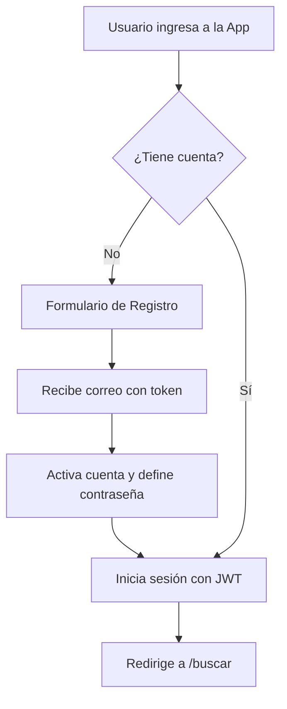
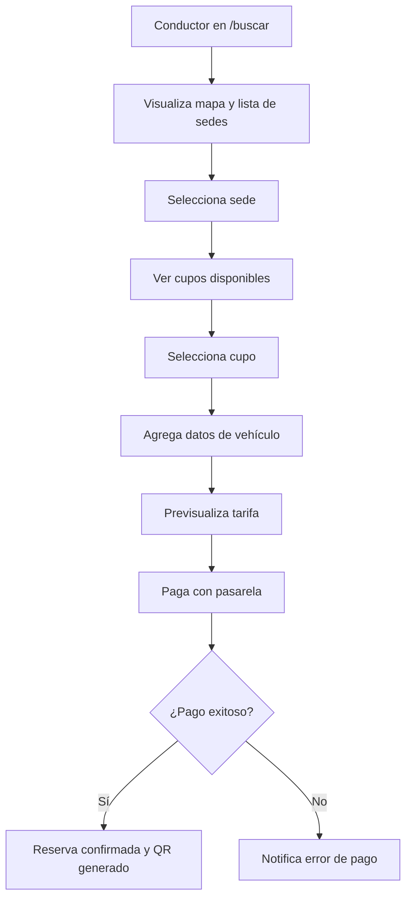
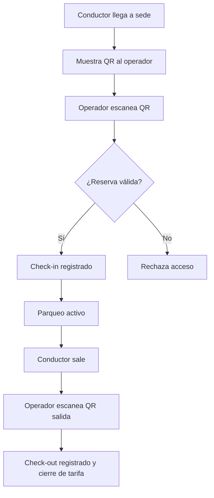
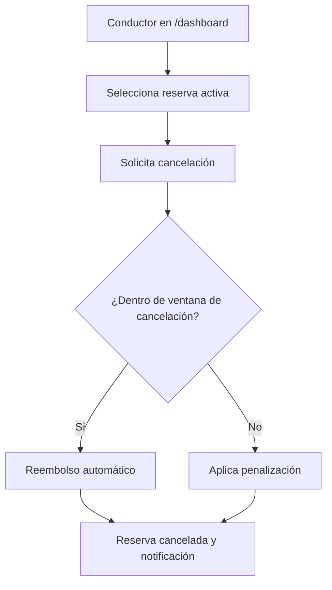
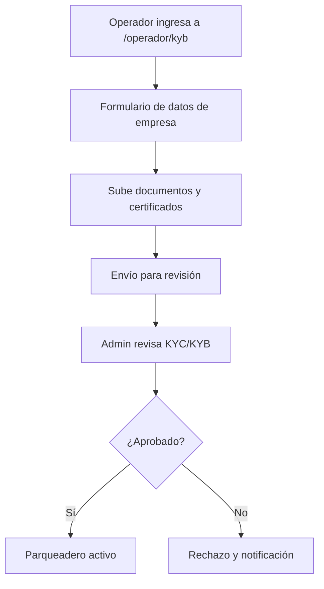
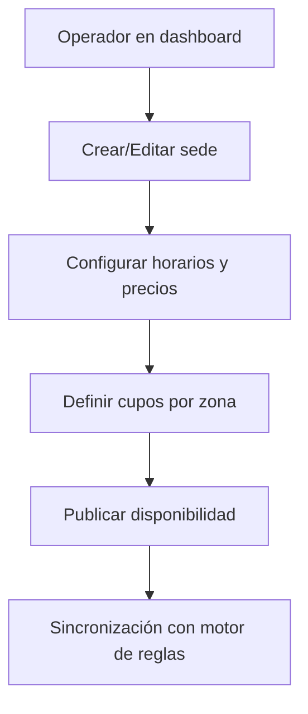
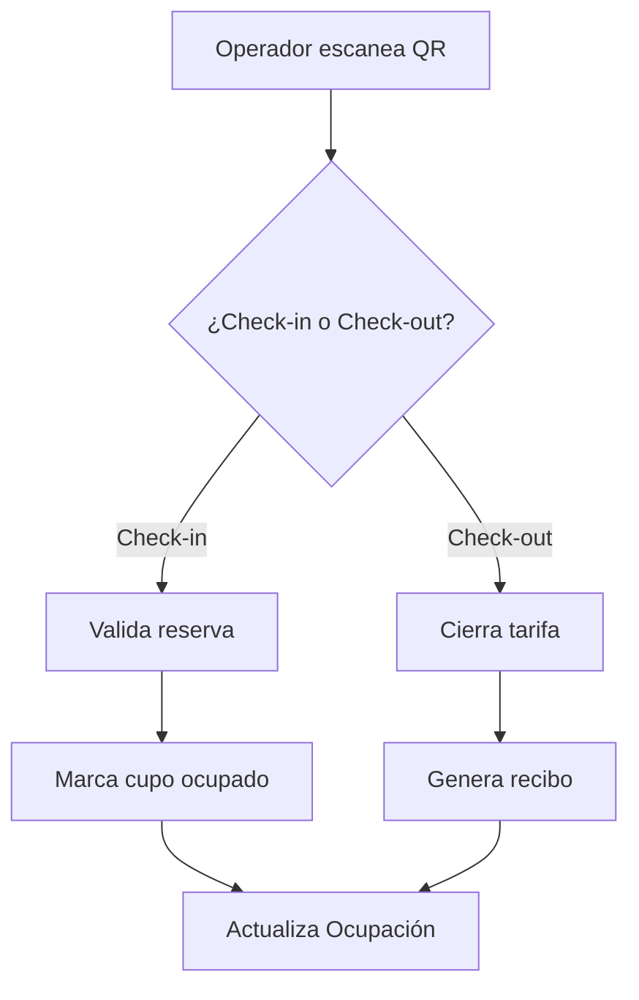
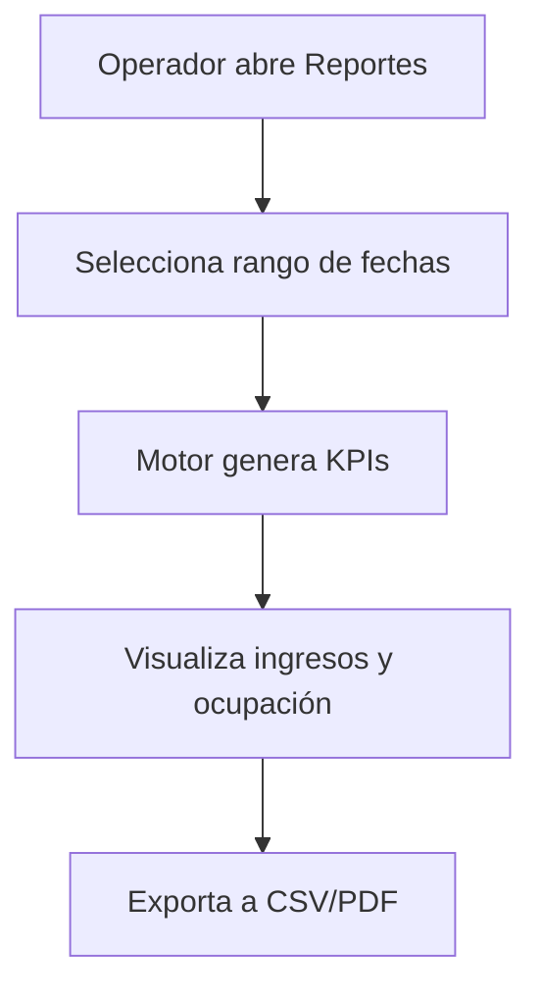
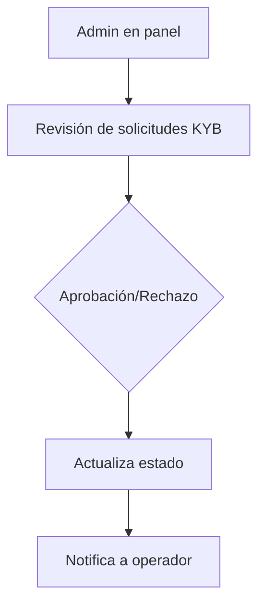
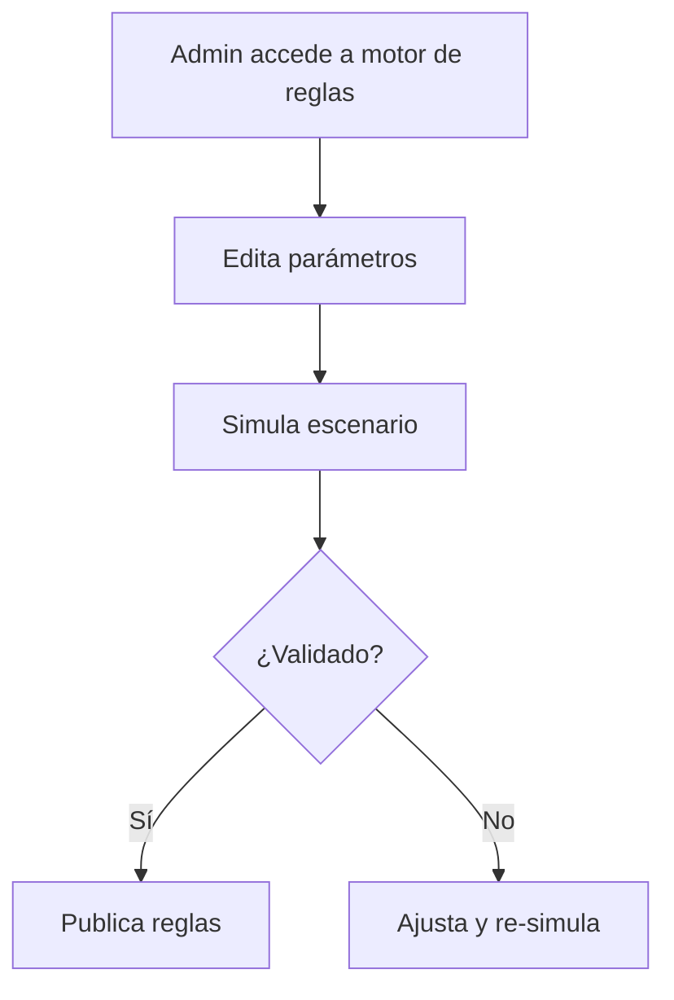

# Mapa Completo de Flujos de Usuario

Este documento detalla los 10 flujos (User Journeys) que componen el ecosistema LOCIFY, garantizando que todos los actores (Conductor, Operador y Administrador) tengan un camino claro y sin fricciones.

## 1. Flujo del Conductor: Autenticación
*   **Actor:** Conductor
*   **Objetivo:** Registrarse y acceder al sistema de forma segura.

## 2. Flujo del Conductor: Búsqueda y Reserva de Cupo
*   **Actor:** Conductor
*   **Objetivo:** Encontrar un parqueadero y reservar un cupo.

## 3. Flujo del Conductor: Check-in y Check-out
*   **Actor:** Conductor
*   **Objetivo:** Ingresar y salir del parqueadero usando la reserva.

## 4. Flujo del Conductor: Cancelación y Reembolso
*   **Actor:** Conductor
*   **Objetivo:** Cancelar una reserva antes del inicio.

## 5. Flujo del Operador: Onboarding KYB
*   **Actor:** Operador / Admin Parqueadero
*   **Objetivo:** Registrar el nuevo parqueadero y validarlo.

## 6. Flujo del Operador: Gestión de Sedes y Cupos
*   **Actor:** Operador
*   **Objetivo:** Configurar sedes, precios y disponibilidad.

## 7. Flujo del Operador: Check-in/Check-out y Pagos
*   **Actor:** Operador / Personal
*   **Objetivo:** Controlar acceso y registrar operaciones.

## 8. Flujo del Operador: Reportes y Finanzas
*   **Actor:** Operador
*   **Objetivo:** Consultar ingresos y ocupación.

## 9. Flujo de Administrador: Moderación de Usuarios y Parqueaderos
*   **Actor:** Administrador
*   **Objetivo:** Aprobar parqueaderos y moderar usuarios.

## 10. Flujo de Administrador: Configuración del Motor de Reglas
*   **Actor:** Administrador
*   **Objetivo:** Parametrizar reglas de precios, cancelación y cupos.

Este mapa de 10 flujos garantiza cobertura completa de los actores y operaciones críticas del negocio.
