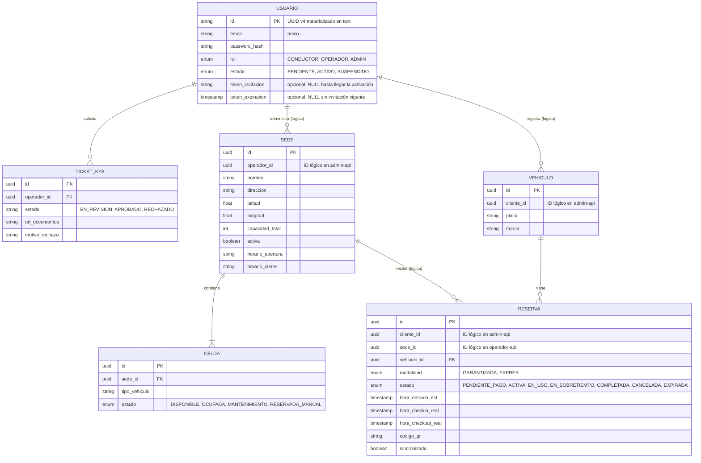
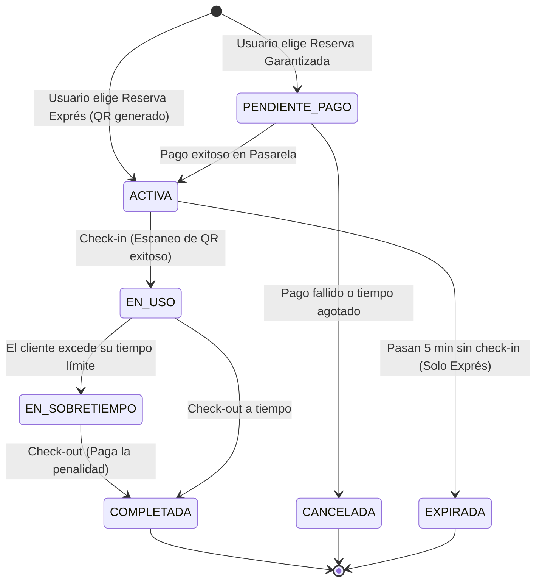

# Modelo de Datos (Database-per-Service)

:::warning Decisión vigente
El [ADR-003](../../adr/ADR-003-monolito-modular-vs-microservicios.md) quedó **Aceptado** el 2026-10-27: los servicios descritos aquí se implementan como **módulos de un monolito modular**, cada uno con su propio esquema en un único clúster PostgreSQL. El diagrama y el diccionario se conservan como **modelo lógico** (fronteras de datos), no como tres despliegues separados.
:::

Para garantizar el desacoplamiento, LOCIFY separa los datos por **dueño**. En el diseño original cada microservicio tenía su propia base de datos PostgreSQL y era el único dueño de su esquema; con la decisión del ADR-003 esa separación se mantiene a nivel de esquema (`admin`, `operador`, `cliente`) dentro de una sola base.

## 1. Diagrama Entidad-Relación (ER) Global

> **Lectura del diagrama:** solo son `FOREIGN KEY` físicas las relaciones dentro de un mismo servicio
> (`USUARIO`→`TICKET_KYB`, `SEDE`→`CELDA`, `VEHICULO`→`RESERVA`). Las relaciones entre servicios
> (`USUARIO`→`SEDE`, `USUARIO`→`VEHICULO`, `SEDE`→`RESERVA`) son **referencias lógicas por UUID**, tal como exige
> el patrón database-per-service descrito en la sección 4.

## 2. Diccionario de Datos (Con ajustes de auditoría)

### 2.1 `admin-api` (Identidad y KYB)

| Tabla | Campo | Tipo | Descripción |
|---|---|---|---|
| **USUARIO** | `id` | TEXT | Llave primaria: un UUID v4 generado por Prisma (`@onCreate`), materializado como `text` (no como tipo `uuid` de PostgreSQL). |
| | `email` | TEXT | Único en el sistema. El contrato usa `String` de Prisma, que se materializa como `text` (sin límite de 255). |
| | `rol` | ENUM | Define los permisos (RBAC). Se persiste como `text` con `CHECK` de valores. |
| | `token_invitacion` / `token_expiracion` | TEXT / TIMESTAMPTZ | Opcionales (`NULL`) según `contract.prisma`: sólo existen en cuentas PENDIENTES de activación. |

### 2.2 `operador-api` (Sedes y Capacidad)

| Tabla | Campo | Tipo | Descripción |
|---|---|---|---|
| **SEDE** | `operador_id` | UUID | ID lógico del usuario en `admin-api`. |
| | `latitud` / `longitud` | DECIMAL | Para el mapa interactivo. |
| | `horario_apertura` / `horario_cierre` | VARCHAR | **NUEVO:** Evita reservas fuera de horario. |
| **CELDA** | `estado` | ENUM | Cambia a OCUPADA, pero permite `RESERVADA_MANUAL` (El 5% del buffer operativo). |

### 2.3 `cliente-api` (Reservas y Conductores)

| Tabla | Campo | Tipo | Descripción |
|---|---|---|---|
| **RESERVA** | `sede_id` | UUID | ID lógico de la sede en `operador-api`. |
| | `estado` | ENUM | **NUEVO ESTADO:** `EN_SOBRETIEMPO` (si el cliente excede el tiempo). |
| | `codigo_qr` | VARCHAR(255) | Hash único generado para el acceso. |
| | `sincronizado` | BOOLEAN | **NUEVO:** Permite el modo offline (Check-in manual). |

---

## 3. Máquina de Estados de una Reserva (Actualizada)

> Este diagrama es el **objetivo** de diseño. `RESERVA` no existe todavía en `contract.prisma` (ver sección 5).

## 4. Estrategia de IDs Lógicos (Cross-Service)

Como cada microservicio tiene su propia base de datos, no usamos llaves foráneas (`FOREIGN KEY`) entre servicios. Usamos UUIDs como IDs lógicos.

- El `cliente-api` guarda el `sede_id` (un UUID).
- Si necesita validar que la sede existe, hace una petición HTTP al `operador-api` (`GET /api/sedes/{id}`).

Esto mantiene las bases de datos aisladas y escalables.

## 5. Estado de implementación: diagrama vs. contrato

El diagrama describe el **modelo objetivo**. El contrato de Prisma (`services/admin-api/src/prisma/contract.prisma`) solo materializa una parte, así que conviene no confundir diseño con código desplegado:

| Entidad del diagrama | Servicio dueño | Estado en `contract.prisma` | Requerimientos que bloquea |
| :--- | :--- | :--- | :--- |
| `USUARIO` | `admin-api` | **Implementado** (7 columnas) | RF-01 a RF-08 |
| `TICKET_KYB` | `admin-api` | No implementado | RF-23, RF-24, RF-29 |
| `SEDE` | `operador-api` | No implementado | RF-24, RF-25, RF-26 |
| `CELDA` | `operador-api` | No implementado | RF-25, RF-26, RF-27 |
| `VEHICULO` | `cliente-api` | No implementado | RF-20 |
| `RESERVA` | `cliente-api` | No implementado | RF-14 a RF-19, RF-21 |

Además, el SRS exige entidades que **no aparecen en el diagrama**:

| Requerimiento | Entidad necesaria |
| :--- | :--- |
| RF-19, RF-28 | `PAGO` / `TRANSACCION` |
| RF-22 | `TICKET_SOPORTE` + `ADJUNTO` |
| RF-28 | `CIERRE_CAJA` |
| RF-30 | `DISPUTA` + `EVENTO_DISPUTA` |
| RF-31 | `REGLA_NEGOCIO` |
| RF-32 | `ROL` / `PERMISO` |
| RNF-02 | `EVENTO_AUDITORIA` (append-only) |
| RNF-03 | `ACEPTACION_POLITICA` |

Por último, `compose.yaml` solo levanta `admin-db`. Las bases `operador_api` y `cliente_api` que exige el patrón todavía no existen, y ningún servicio además de `admin-api` tiene código.