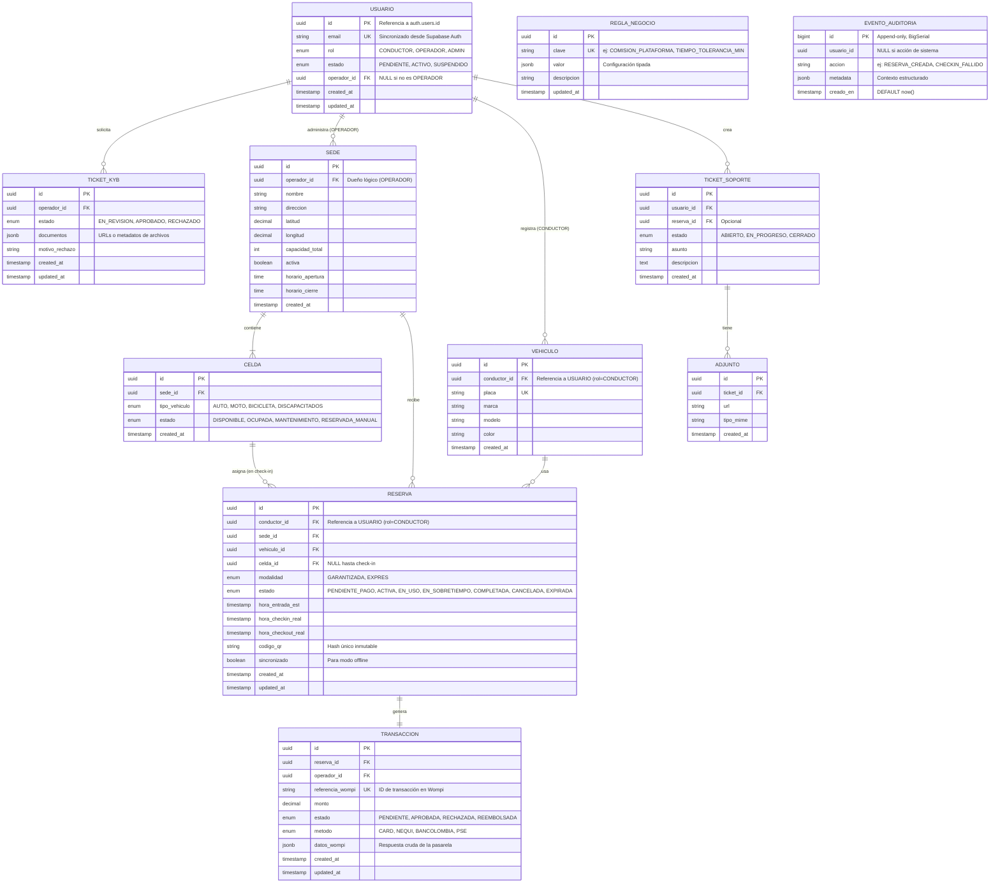
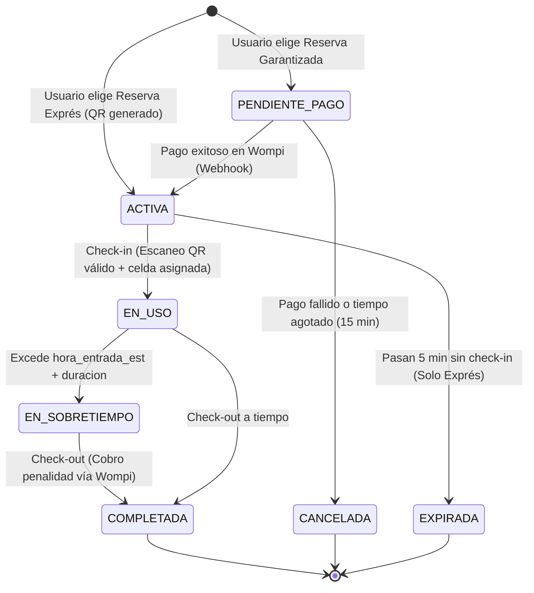

# Modelo de Datos (Supabase + RLS)

:::info Decisión vigente
El **ADR-003** (Monolito Modular) y el **ADR-005** (Arquitectura Dual Next.js + Fastify) establecen la arquitectura actual:
- **Frontend & API Pública:** Next.js 14+ (App Router, Server Actions) consume Supabase directamente (PostgREST + Realtime + Auth).
- **Backend de Negocio Complejo:** Fastify orquesta lógica pesada (QR, Wompi, Cron Jobs) y se conecta a la **misma** base de datos Supabase (PostgreSQL) mediante Prisma ORM.
- **Seguridad de Datos:** **Row Level Security (RLS)** es la única fuente de verdad para el control de acceso multi-tenant. No hay `database-per-service`; es un único cluster PostgreSQL gestionado por Supabase con esquemas lógicos por dominio.
:::

## 1. Diagrama Entidad-Relación (ER) Global

## 2. Políticas de Seguridad (Row Level Security - RLS)

> **Principio Constitucional:** Supabase RLS es la primera línea de defensa. Todas las tablas habilitan RLS. Las políticas se definen en migraciones SQL y se versionan con el código.

| Tabla | Política | Expresión SQL (Resumen) |
|-------|----------|-------------------------|
| `USUARIO` | `select_own` | `auth.uid() = id` |
| `USUARIO` | `select_operador_sedes` | `EXISTS (SELECT 1 FROM SEDE s WHERE s.operador_id = auth.uid() AND s.id = USUARIO.operador_id)` |
| `SEDE` | `select_public_active` | `activa = true` (para búsqueda pública) |
| `SEDE` | `crud_operador` | `operador_id = auth.uid()` |
| `CELDA` | `select_sede_operador` | `EXISTS (SELECT 1 FROM SEDE s WHERE s.id = sede_id AND s.operador_id = auth.uid())` |
| `VEHICULO` | `crud_conductor` | `conductor_id = auth.uid()` |
| `RESERVA` | `select_conductor` | `conductor_id = auth.uid()` |
| `RESERVA` | `select_operador_sede` | `EXISTS (SELECT 1 FROM SEDE s WHERE s.id = sede_id AND s.operador_id = auth.uid())` |
| `RESERVA` | `insert_conductor` | `conductor_id = auth.uid() AND modalidad IN ('GARANTIZADA','EXPRES')` |
| `TRANSACCION` | `select_participantes` | `conductor_id = auth.uid() OR operador_id = auth.uid()` |
| `TICKET_SOPORTE` | `select_own` | `usuario_id = auth.uid()` |
| `TICKET_KYB` | `select_operador` | `operador_id = auth.uid()` |
| `TICKET_KYB` | `insert_operador` | `operador_id = auth.uid() AND estado = 'EN_REVISION'` |

## 3. Migraciones y Versionado

- **Herramienta:** Supabase CLI (`supabase migration new`, `supabase db push`).
- **Estrategia:** Migraciones **aditivas y reversibles** siempre que sea posible.
- **Índices:** Creados `CONCURRENTLY` en producción para tablas grandes (`RESERVA`, `EVENTO_AUDITORIA`).
- **RLS:** Las políticas se crean en la misma migración que la tabla (`ALTER TABLE ... ENABLE ROW LEVEL SECURITY; CREATE POLICY ...`).

## 4. Máquina de Estados de una Reserva (Actualizada)

## 5. Integración Next.js ↔ Supabase ↔ Fastify

| Capa | Responsabilidad | Acceso a Datos |
|------|-----------------|----------------|
| **Next.js (Server Actions / API Routes)** | UI, Búsqueda pública, Autenticación (Supabase Auth), Reservas Exprés | Cliente Supabase JS (`createServerClient`) — respeta RLS automáticamente via JWT del usuario |
| **Fastify (Servicios Internos)** | Lógica de QR, Webhooks Wompi, Jobs Cron (expiración, cierres de caja), Disputas | Prisma ORM (connection pooling PgBouncer) — **Bypasa RLS** usando `service_role_key` solo en operaciones de sistema auditadas (`EVENTO_AUDITORIA`) |
| **Supabase Realtime** | Ocupación en vivo (`CELDA.estado`), Notificaciones push | Canales filtrados por `sede_id` (Operador) o `conductor_id` (Cliente) |

## 6. Estado de Implementación (Checklist)

| Entidad | Migración SQL | RLS Policies | Prisma Schema | Next.js Types | Estado |
|---------|---------------|--------------|---------------|---------------|--------|
| `USUARIO` (perfil) | ✅ | ✅ | ✅ | ✅ | **Done** |
| `TICKET_KYB` | ✅ | ✅ | ✅ | ✅ | **Done** |
| `SEDE` | ✅ | ✅ | ✅ | ✅ | **Done** |
| `CELDA` | ✅ | ✅ | ✅ | ✅ | **Done** |
| `VEHICULO` | ✅ | ✅ | ✅ | ✅ | **Done** |
| `RESERVA` | ✅ | ✅ | ✅ | ✅ | **Done** |
| `TRANSACCION` | 🟡 Parcial | 🟡 Parcial | 🟡 Parcial | 🟡 Parcial | **WIP (Wompi)** |
| `TICKET_SOPORTE` / `ADJUNTO` | ⏳ Pendiente | ⏳ Pendiente | ⏳ Pendiente | ⏳ Pendiente | **Backlog** |
| `REGLA_NEGOCIO` | ✅ | ✅ (solo ADMIN) | ✅ | ✅ | **Done** |
| `EVENTO_AUDITORIA` | ✅ | ❌ (Solo service_role) | ✅ | ❌ | **Done** |

---

> **Nota para auditores SENA:** Este documento refleja la arquitectura **implementada y desplegada** (no solo teórica). La base de datos única en Supabase con RLS garantiza aislamiento multi-tenant sin complejidad operativa de múltiples clusters.